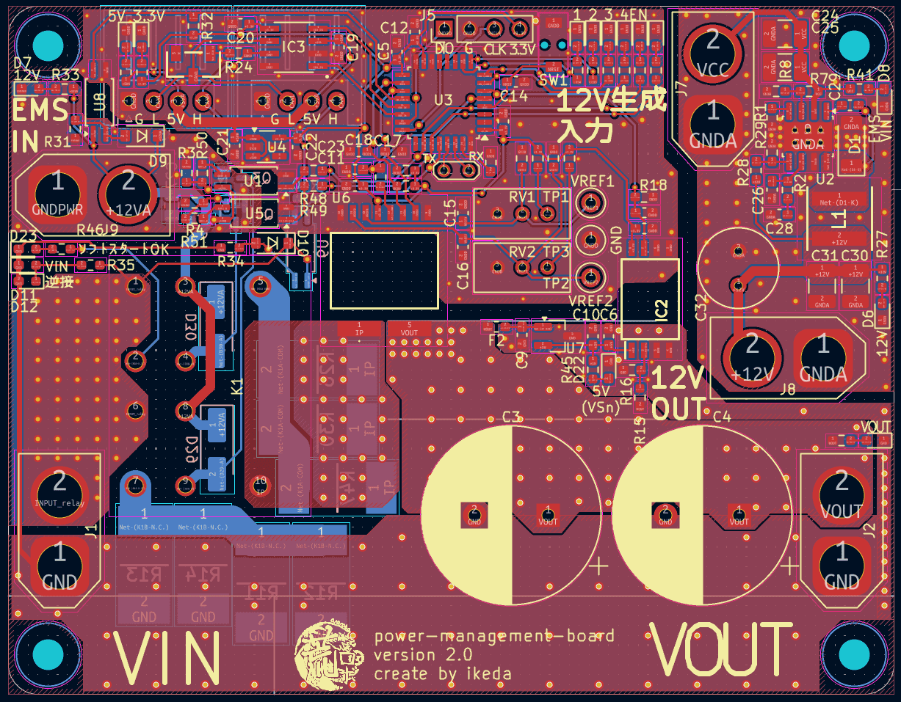
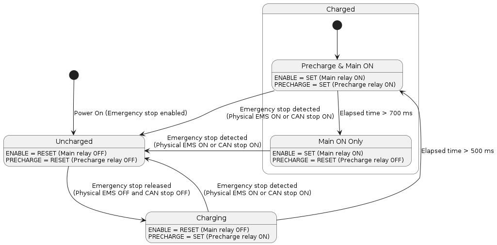
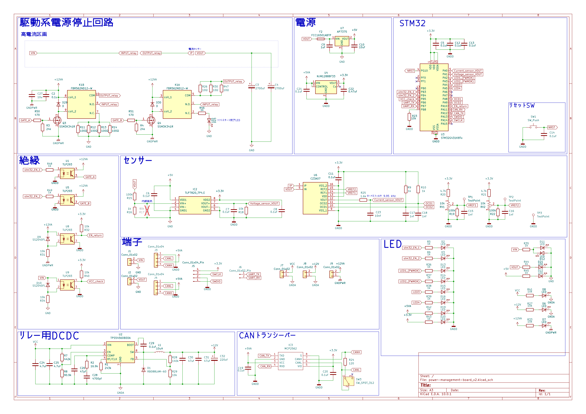

# Power Management Board

[日本語版](./README_jp.md)

A power management board for robot battery monitoring, soft-start control, and drive power cutoff.

## Table of Contents

1. [Overview](#1-overview)
2. [Features](#2-features)
3. [State Machine](#3-state-machine)
4. [Schematic](#4-schematic)
5. [LED Indicators](#5-led-indicators)
6. [CAN Communication](#6-can-communication)
7. [Contributing](#7-contributing)
8. [License](#8-license)

## 1. Overview

This board reduces battery management costs and provides reliable drive power cutoff.
An STM32G431K8T6 controls all onboard functions.

## 2. Features

### Soft-Start Function
Implements a soft-start circuit to reduce inrush current.
A precharge resistor is connected via a relay to charge the capacitors at low current.
After 500 ms of precharging, the main relay turns on, and the precharge relay turns off after 700 ms.

### Current and Voltage Measurement
Measures output current and voltage via ADC with DMA.
Used to monitor battery condition and analyze total robot power consumption.
Over-current detection pins are also monitored.

### Control and Drive Isolation
The control circuit and drive power circuit are electrically isolated using photocouplers.

### Emergency Stop Function
Cuts off drive power using automotive relays.
Supports two cutoff methods:
- Cutoff via an external physical emergency stop switch.
- Cutoff via CAN command controlling relay switching through the STM32 GPIO.

### Bulk Capacitors
Two 2700 uF electrolytic capacitors (UHE1H272MHD) are mounted on the output to suppress motor regenerative voltage and stabilize power during transient current spikes.
Each capacitor is rated for 3.8 A ripple current, providing 7.6 A total ripple current handling.

## 3. State Machine

Output relays are controlled according to the emergency stop state and the capacitor charge state.

## 4. Schematic

## 5. LED Indicators

| Name | Color | Specification |
| :---: | :---: | :--- |
| LED1 | Red | Blinks every 500 ms in the main loop |
| LED4 | Green | Lights up when initialized via CAN |

## 6. CAN Communication

- **Receive:**
  - Initialization config (sets sensor transmission rate and turns on LED4)
  - Remote emergency stop command
- **Transmit:**
  - Sensor data (voltage and current at the configured interval, default 1000 ms)
  - Status data (emergency stop state, remote emergency stop state, and over-current state on change)

## 7. Contributing

Please refer to [CONTRIBUTING.md](./CONTRIBUTING.md).

## 8. License

This repository is licensed under the [MIT License](./LICENSE).
