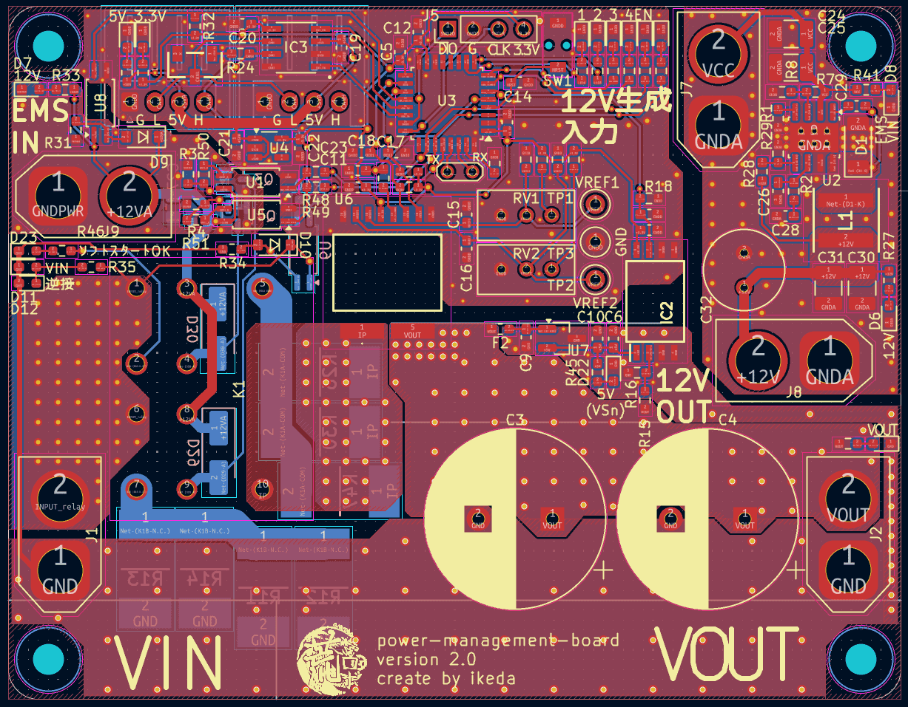
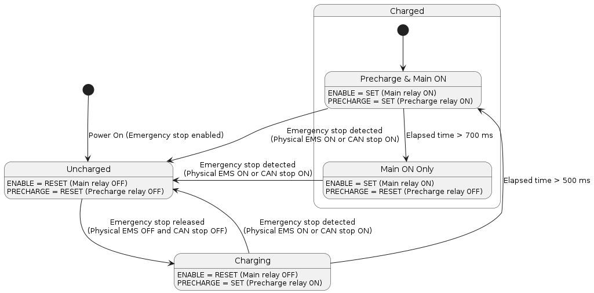
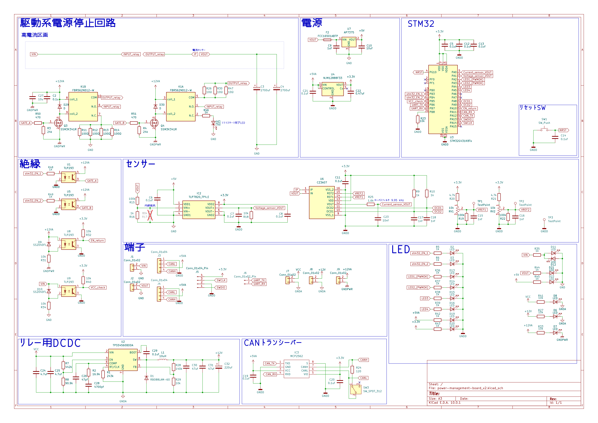

# 電源管理基板

[English README](./README.md)

ロボットのバッテリー管理・駆動系電源遮断を行う基板である。

## 目次

1. [概要](#1-概要)
2. [機能](#2-機能)
3. [状態遷移](#3-状態遷移)
4. [回路図](#4-回路図)
5. [LEDインジケータ](#5-ledインジケータ)
6. [CAN通信](#6-can通信)
7. [コントリビューション](#7-コントリビューション)
8. [ライセンス](#8-ライセンス)

## 1. 概要

バッテリー管理コスト削減および駆動系電源遮断を目的とする。
STM32G431K8T6を搭載し、各機能を統括する。

## 2. 機能

### ソフトスタート機能
突入電流を軽減する目的でソフトスタート機能を実装。
ソフトスタート用抵抗器がプリチャージリレーによって接続され、コンデンサへの低電流充電を実現する。
充電開始から500ms後にメインリレーを導通し、700ms後にプリチャージリレーを遮断する。

### 電流・電圧計測機能
出力される電流値および電圧値をADCとDMAを用いて計測する。
バッテリーの状態を判断し、ロボットの総消費電流を分析する目的である。
過電流検出信号の監視も行う。

### 制御系・駆動系の絶縁
制御系と駆動系の絶縁はフォトカプラによって実装。

### 非常停止機能
車載用リレーを用いた駆動系電源遮断機能を持つ。
外部接続非常停止スイッチの電源遮断による遮断と、STM32のGPIOによるリレースイッチング制御（CAN通信経由）の2種類の遮断方法がある。

### バルクコンデンサ
モーターの回生電圧を抑え、過渡的な電流上昇時の電源安定を目的とし、2700uFの電解コンデンサを2つ出力部に搭載。
UHE1H272MHDであり、ひとつあたりのリップル電流は3.8Aであるため、合計7.6Aの過渡的な電流増大を軽減できる。

## 3. 状態遷移

非常停止状態とコンデンサ充電状態に応じて、出力リレーを制御する。

## 4. 回路図

## 5. LEDインジケータ

|名称|色|仕様|
|:-:|:-:|:-:|
|LED1|赤|メイン処理ループにて500ms周期で点滅|
|LED4|緑|初期化済み（CAN疎通確認）|

## 6. CAN通信

- **受信**
  - 初期設定コマンド（センサ送信周期を設定し、LED4を点灯）
  - 遠隔非常停止コマンド
- **送信**
  - センサ値（電圧・電流を設定周期ごとに送信、初期値1000ms）
  - 状態（非常停止、遠隔非常停止、過電流の各状態に変化があった場合に送信）

## 7. コントリビューション

[CONTRIBUTING.md](./CONTRIBUTING.md) を参照してください。

## 8. ライセンス

本リポジトリは [MITライセンス](./LICENSE) のもとで公開されています。
